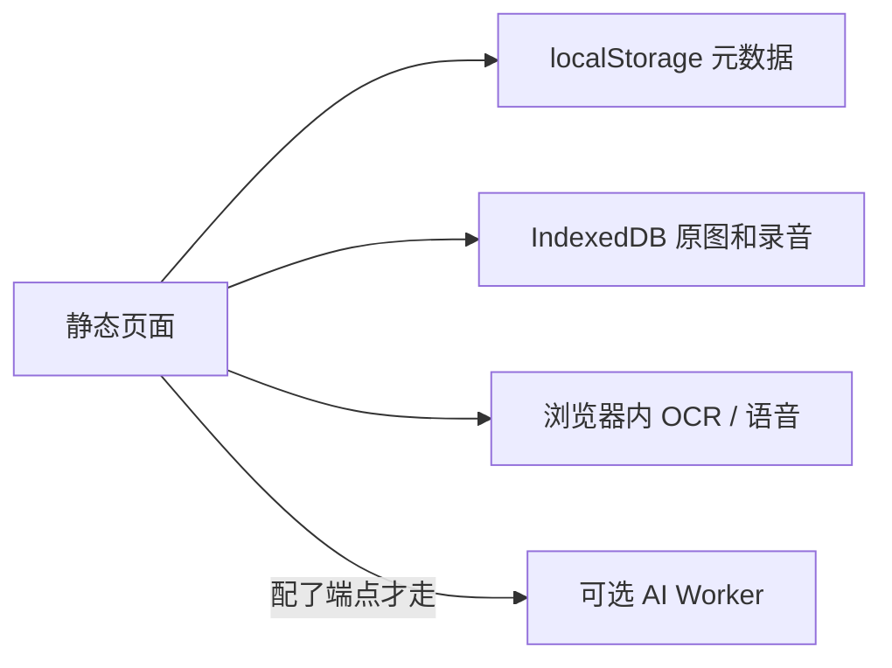

# 架构

伴成长现在是一个浏览器里的单页应用。没有应用服务器，没有账号系统，也没有 SQL 数据库。

## 页面

`index.html` 加载 `assets/` 里的脚本和样式，路由是哈希路由，方便挂在子路径上。`/agent` 只显示「正在建设中」。

和页面一起发布的小模块：

- `src/lib/medicalUploadQueue.js`：医疗文件按队列项 id 入队
- `src/lib/medicalFieldMerge.js`：提取结果写回前和最新记录合并
- `src/lib/aiConfidence.js`：置信度只接受 0 到 1

## 浏览器里的三份档案

| 键 | 内容 |
|---|---|
| `banchengzhang:v01:db` | 监护人、孩子、照片和照片任务 |
| `banchengzhang:v01:f02` | 语音事件 |
| `banchengzhang:v01:medical` | 医疗文件、记录、字段和任务 |

大文件在 IndexedDB 库 `banchengzhang:v01:media`。医疗上传队列在 `sessionStorage`，刷新后内存里的 `File` 不在了，对应队列项会失败，并提示重新选择。

每次写入都会重新读出整份 JSON 再写回。提取阶段如果跨过一次等待，写回时必须重读这条记录，不能用等待前的快照覆盖用户刚改过的字段。

## 可选的云端代理

`deploy/ai-proxy/worker.js` 提供：

- `POST /api/medical/extract`
- `POST /api/asr`

页面只有在构建时写了 `VITE_AI_ENDPOINT` 才会把请求发到这里。密钥留在 Worker 的 secret 里。当前这个已发布页面包没有注入 `VITE_AI_PROXY_TOKEN`，所以不会发送调用方令牌。
